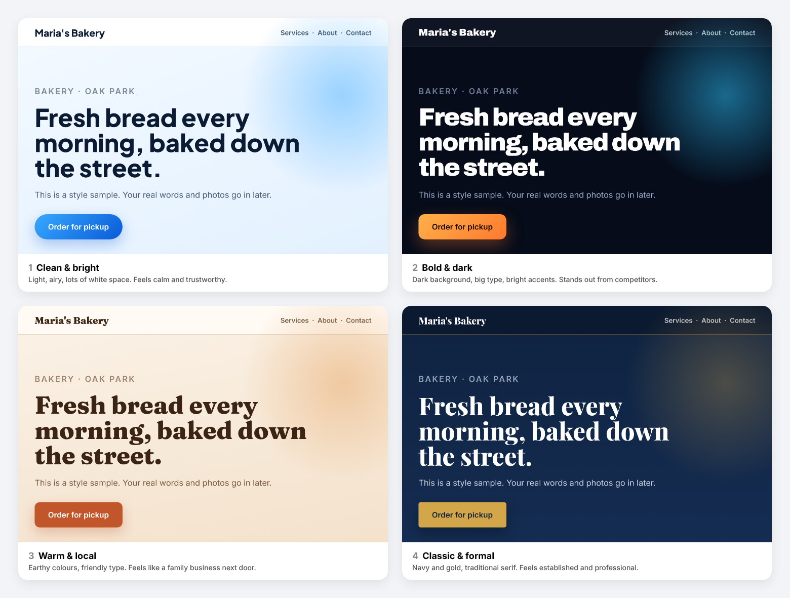

# launch-my-site

**A free Claude skill that takes anyone from "I want a website" to a live site on their own domain, in about an hour, with no technical knowledge needed.**

You talk to Claude like you'd talk to a web designer. It asks a few plain questions about your business, shows you style samples with your own name on them, builds the site, checks it on desktop and phone, and helps you put it live on your own web address. It doesn't ask you to find passwords or learn what "DNS" means.

**Watch the 1-minute explainer:** [launch-my-site-explainer-720p.mp4](media/launch-my-site-explainer-720p.mp4) · [How it works](https://dhirajmakam.com/launch-my-site-how-it-works/)



## What it does

It works like a small web agency: five phases (discovery, look, build and check, go live, handover), each ending with a short recap and your yes. New here? Read the [user guide](docs/how-to-use.md).


- **Asks, in plain language.** One or two questions at a time: what the site is for, what visitors should do, what to read first. For common small businesses (home services, restaurants, salons, professional services, contractors) it already knows what usually matters and only asks about the gaps.
- **Lets you pick a look by pointing.** It asks for websites you like and any logo or colours you already use. If you have nothing in mind, it shows four style samples with your business name on them.
- **Shows you before anything goes live.** Two design directions, then the full site, with screenshots on desktop and phone. Nothing is published until you say "yes, publish it."
- **Works out your hosting for you.** Give it your web address. It figures out whether you're on regular web hosting, WordPress, a site builder (Wix, Squarespace, Shopify, Webflow) or nothing yet, and tells you what it found.
- **Uses the easiest way to publish.** In order: a "Connect" button, an email invite, you log in and Claude does the work while you watch, a file you drag in, or a message to your hosting company. Passwords and access codes are a last resort.
- **Checks everything, and shows you.** A QA report covers every page on phone, tablet and desktop: links, images, search basics, your phone number on every page, forms that actually send.
- **Publishes safely.** It protects your email settings, checks it's changing the right site, backs up anything it replaces, never deletes anything, and checks every page once it's live.
- **Hands over properly.** A short handover document: what's live, what you own, access removed, and a checklist for your first 30 days.
- **Works for you or for someone else.** Use it for your own business, or as a freelancer or friend building a site for someone who isn't in the conversation.

## Install

**In the Claude app (claude.ai or desktop)**

1. **Download [`launch-my-site.zip`](https://github.com/dmakam/launch-my-site/raw/main/dist/launch-my-site.zip).** Use this link, not GitHub's green "Code → Download ZIP" button. That button names the folder `launch-my-site-main`, and Claude rejects a skill whose folder name doesn't match the skill name.
2. **Turn on code execution** if it isn't already: Settings → Capabilities → "Code execution and file creation". On Team and Enterprise plans, an admin controls this.
3. **Upload the skill.** Go to Customize → Skills, click **+**, choose **Create skill → Upload a skill**, and pick the zip. Then switch the skill on.
4. **Start a chat** and say something like: *"Build me a website for my bakery and put it on mybakery.com."*

Skills work on Free, Pro, Max, Team and Enterprise plans. See [Use skills in Claude](https://support.claude.com/en/articles/12512180-use-skills-in-claude) if the upload fails.

**In Claude Code**

```bash
git clone https://github.com/dmakam/launch-my-site ~/.claude/skills/launch-my-site
```

### Optional script requirements

The skill includes helper scripts that Claude runs for you:

| Script | What it does | Needs |
|---|---|---|
| `scripts/project.py` | Keeps the project file: facts, decisions, approvals, the brief | Python only |
| `scripts/detect_site.py` | Finds out where a domain's website lives | `pip install requests` |
| `scripts/dns_snapshot.py` | Protects email: records DNS before launch, compares after | `pip install requests` |
| `scripts/qa_report.py` | Pass/fail QA report with screenshots | `pip install playwright requests` and `playwright install chromium` |
| `scripts/style_cards.py` | Renders the style samples | `pip install playwright` and `playwright install chromium` |
| `scripts/verify_live.py` | Checks every page, image and share preview once live | `pip install requests` |
| `scripts/deploy_cpanel.py`, `deploy_sftp.py`, `publish_wordpress.py` | Repeatable publishing, only if you choose it | `requests`, plus `paramiko` for SFTP |

## How it's organised

```
SKILL.md                     the flow and the ground rules
references/engagement.md     phases, gates, project file, brief, recaps
references/interview.md      the questions, in plain words
references/style-cards.md    the visual style menu
references/industry-starters.md
references/detect-host.md    working out the hosting from a web address
references/publish-routes.md the decision table and the access ladder
references/route-*.md        one guide per hosting situation
references/credentials.md    last-resort access, step by step
references/on-behalf.md      building for someone else
references/copy-and-seo.md   voice, copywriting, local SEO
references/build.md          design, build and QA
references/launch-runbook.md go-live checklists, email protection, redirects
references/handover.md       the handover document
scripts/                     project file, detection, style cards, QA, DNS, publishing, live checks
evals/                       scripted owner scenarios and grading
docs/how-to-use.md           user guide
```

## Privacy and safety

- Access codes, if you ever use them, stay in a local `.env` file on your machine. They are never pasted into chat.
- Claude only touches the one site you asked it to publish.
- Claude doesn't invent reviews, licences or facts about your business. If you don't confirm something, it stays off the site.

## Testing changes

If you modify the skill, run the scenarios in `evals/` in a fresh chat with no memory (for example, an incognito chat in Claude), playing the scripted owner. Grade with `evals/grade.md`. Ship only when every "must" rule passes.

## License

MIT. See [LICENSE](LICENSE). Made by [Dhiraj Makam](https://dhirajmakam.com).
