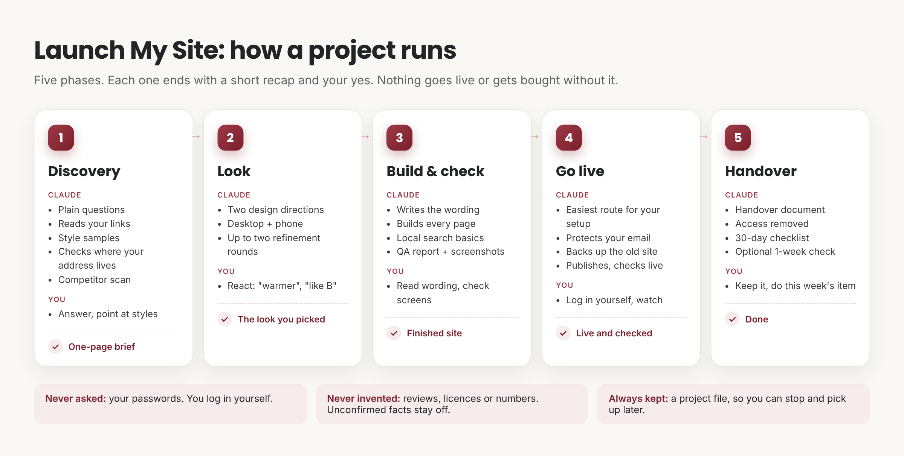

# How to use Launch My Site

A practical guide for business owners, and for anyone building a site for someone else.

## Before you start (5 minutes, once)

1. **Install the skill:** download [`launch-my-site.zip`](https://github.com/dmakam/launch-my-site/raw/main/dist/launch-my-site.zip), then in Claude go to Customize → Skills → **+** → Create skill → Upload a skill, and switch it on.
   On a Mac, Safari may unzip it into a `launch-my-site` folder. Right-click the folder in Finder → **Compress "launch-my-site"**, then upload that zip.
2. **Turn on code execution** (Settings → Capabilities → "Code execution and file creation"). The skill runs small programs to check your site.
3. **Optional, but it makes things smoother:** the Claude in Chrome extension. With it, Claude can do the publishing steps in your browser while you watch, after you've logged in yourself.

## Have these ready (it's fine if you don't)

- Your **web address**, if you have one (e.g. mybakery.com).
- **Links Claude can read:** your current site, Google Business profile, Facebook or Instagram. Claude pulls hours, services and reviews from these so you don't have to type them.
- Your **logo** and a few **photos** you own (phone photos are fine).
- Two or three **websites you like the look of**, any industry.
- About **30–60 minutes** across one or two sittings.

## Start it

Open a new chat and say what you want in your own words:

> "Build me a website for my bakery and put it on mybakery.com."

> "I'm building a site for my aunt's dental clinic. She owns brightsmile.com."

That's it. Claude takes it from there.

## What happens: five phases

Each phase ends with a short summary and **your yes** before the next one starts. Nothing goes live, and nothing is bought, without your clear OK.

| Phase | What Claude does | What you do | Ends with |
|---|---|---|---|
| **1. Discovery** | Asks a few plain questions, reads your links, shows style samples if you're unsure, checks where your address is hosted, looks at local competitors | Answer, point at styles you like | A **one-page brief**. You say yes. |
| **2. Look** | Shows two design directions, desktop and phone | React honestly: "too dark", "more like the second" | The **look you picked** |
| **3. Build and check** | Writes the wording, builds every page, runs a **QA report** (phones, links, images, search basics, your phone number on every page) | Read the wording, look at the screenshots | Your yes on the **finished site** |
| **4. Go live** | Explains the easiest way to publish for *your* setup, protects your email, backs up your old site, publishes, checks the live site | Usually: log in to your hosting yourself, then watch | Your site, **live and checked** |
| **5. Handover** | Writes a **handover document**: what's live, what was checked, what you own, access removed, a 30-day checklist | Keep it; do the one thing on this week's list | Done. Optional one-week check. |

## Tips for the best result

- **Answer in your own words.** "We're the guys who actually show up on time" makes better copy than "reliable service". Claude uses your words.
- **React to pictures, not adjectives.** You don't need to know fonts or colours. Say what you feel when you look at the samples.
- **Only confirmed facts go on the site.** If Claude asks "can you confirm your licence number?", that's why. Anything unconfirmed is left off, never guessed.
- **You never need to share a password.** If Claude needs access to your hosting, you'll log in yourself. If you ever paste one by accident, change it; Claude won't use it.
- **"I don't know" is a good answer.** Claude will look it up, show you options, or pick a sensible default and tell you.
- **Short on time?** Say "keep it quick". Each approval becomes a one-line yes.
- **Coming back later?** At the end of each phase Claude sends you a small project file. In a new chat, attach it and say "I'm back", and Claude picks up where you left off. (In the same chat, just say "I'm back".)

## Your email is safe

If your web address also handles your email, Claude records your current settings before anything changes, changes only the website part, and checks your email settings again afterwards. If anything changed, it restores them first.

## Building for someone else

Say so at the start ("I'm building this for my client"). Claude will:
- make sure access comes **from the owner to you** (an invite, or the owner logging in), never their password through you;
- write the exact message to send the owner;
- give the owner their own handover document, including how to remove your access.

## Changes after launch

Just ask: "Change the opening hours to 8am" or "Add a page for catering". If you said you'll want regular changes, Claude can set up a repeatable way to update the site (with your OK), so you don't have to log in each time.

## If something goes wrong

- **Old version still showing:** press Ctrl+Shift+R (Cmd+Shift+R on a Mac). New visitors already see the new site.
- **Something looks broken:** tell Claude what you see (a screenshot helps). The old site was backed up and can be restored in one step.
- **Upload of the skill fails:** use the zip link above, not GitHub's green "Code → Download ZIP" button.
